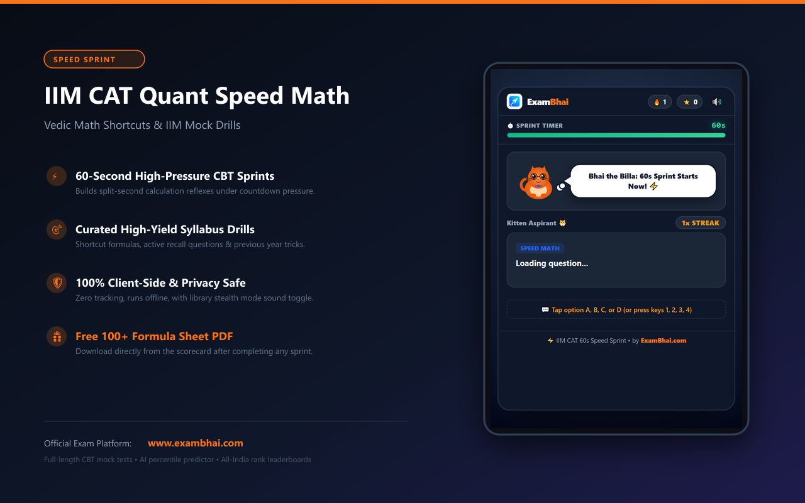
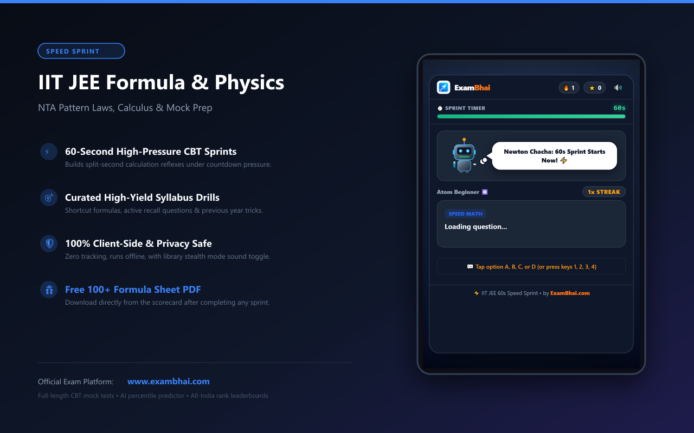
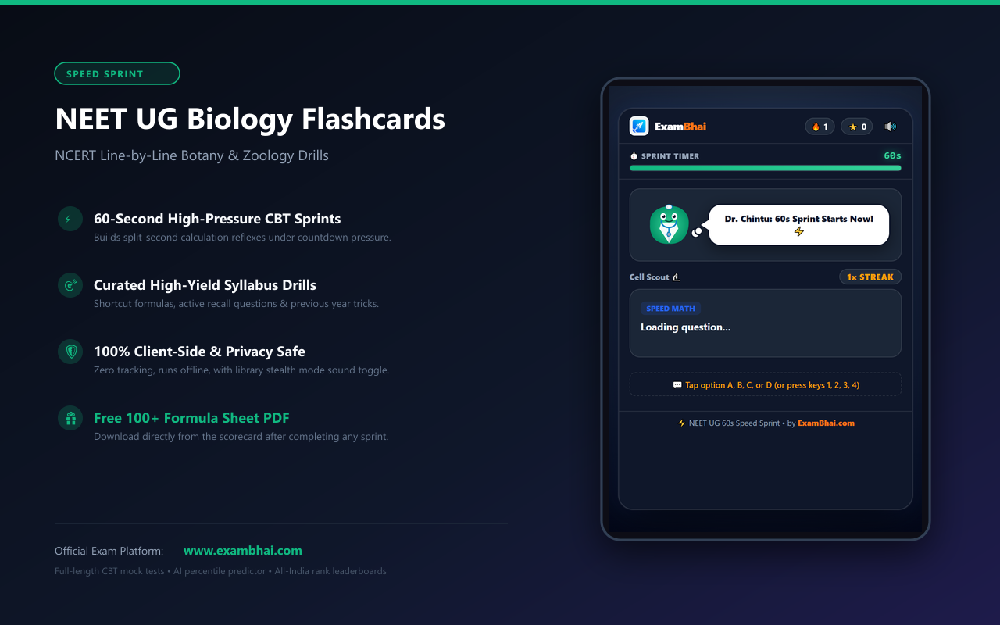
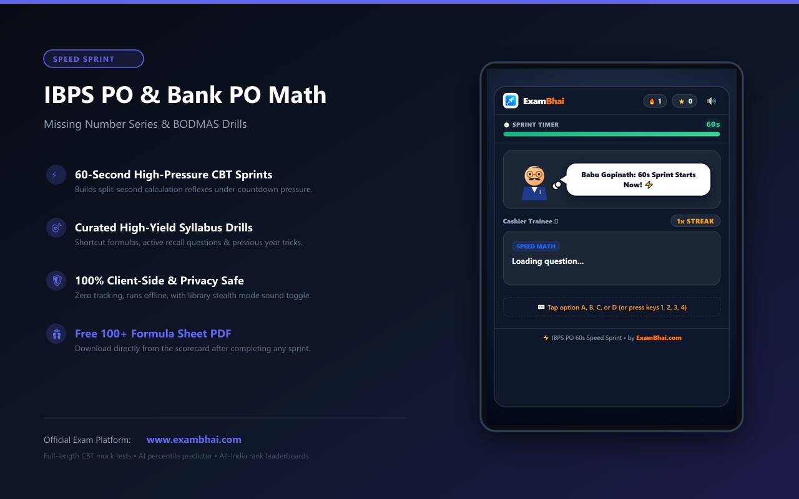

# ⚡ ExamBhai Speed Sprint Extensions Hub

Welcome to the official documentation and distribution hub for the **ExamBhai Speed Sprint Browser Extension Series**. 

ExamBhai builds high-adrenaline, 60-second mental math drills, active recall flashcards, and formula sheet study companions engineered for India's most competitive entrance examinations.

Official Web Platform: **[https://www.exambhai.com](https://www.exambhai.com)**  
Official GitHub Pages: **[https://jiteshtripathimath-lab.github.io/speed-math-extensions-exambhai/](https://jiteshtripathimath-lab.github.io/speed-math-extensions-exambhai/)**  
Explore Mock Test Passes & Pricing: **[https://www.exambhai.com/pricing](https://www.exambhai.com/pricing)**

---

## 🚀 The ExamBhai Extension Suite

Below are the 8 dedicated browser extensions designed for specific competitive exams. Each extension provides daily 60-second speed drills, active recall formula flashcards, desi roast commentary, and direct access to authoritative exam hubs and free full-length CBT mock tests.

| Exam | Extension Name & Focus | Mascot | Authoritative Hub & Free Mock | Store Status |
|---|---|---|---|---|
| **IIT JEE** | **IIT JEE Formula & Physics** _Kinematics, rotational dynamics, calculus shortcuts, organic reagents_ | Newton Chacha 🍎 | • [IIT JEE Mains Syllabus & PYQ Hub](https://www.exambhai.com/exams/hub/iit-jee-mains-2027) • [Launch Free JEE Mains Mock](https://www.exambhai.com/practice/free/iit-jee-mains-2027-mock) | **Published - Public** ([Chrome Web Store](https://chromewebstore.google.com/search/ExamBhai)) |
| **IIM CAT** | **IIM CAT Quant Speed Math** _Vedic math shortcuts, %-fraction drills, arithmetic speed_ | Bhai the Billa 😼 | • [IIM CAT Quant Syllabus & Hub](https://www.exambhai.com/exams/hub/iim-cat-2026) • [Launch Free CAT Mock](https://www.exambhai.com/practice/free/iim-cat-2026) | **Published - Public** ([Chrome Web Store](https://chromewebstore.google.com/search/ExamBhai)) |
| **NEET UG** | **NEET UG Biology Flashcards** _NCERT line-by-line botany, zoology, genetics, human physiology_ | Dr. Chintu 🩺 | • [NEET UG Biology Syllabus Hub](https://www.exambhai.com/exams/hub/neet-2027) • [Launch Free NEET 720 Mock](https://www.exambhai.com/practice/free/neet-2027-mock) | In Review (Edge, Opera) |
| **IBPS PO** | **IBPS PO / Bank PO Math** _Missing number series, simplification, BODMAS approximations_ | Babu Gopinath ☕ | • [IBPS PO Prelims & Quant Hub](https://www.exambhai.com/exams/hub/ibps-po-probationary-officer-prelims) • [Launch Free IBPS PO Mock](https://www.exambhai.com/practice/free/ibps-po-probationary-officer-prelims-mock) | In Review (Edge, Opera) |
| **SSC CGL** | **SSC CGL Math & GK Tricks** _Trigonometry shortcuts, geometry theorems, static GK flashcards_ | Inspector Pandey 👮‍♂️ | • [SSC CGL Tier 1 Math & GK Hub](https://www.exambhai.com/exams/hub/ssc-cgl-tier-1) • [Launch Free SSC CGL Mock](https://www.exambhai.com/practice/free/ssc-cgl-tier-1-mock) | In Review (Edge, Opera) |
| **UPSC CDS** | **UPSC CDS Math & GK Sprint** _Elementary math, military history, defense commands, current affairs_ | Major Thapa 🎖️ | • [UPSC CDS Elementary Math Hub](https://www.exambhai.com/exams/hub/cds-2027) • [Launch Free CDS Mock](https://www.exambhai.com/practice/free/cds-2027-mock) | In Review (Edge, Opera) |
| **AFCAT** | **AFCAT Air Force Speed Math** _Flight aptitude, spatial reasoning, aircraft specs, numerical ability_ | Cadet Baaz 🦅 | • [AFCAT Air Force Speed Math Hub](https://www.exambhai.com/exams/hub/afcat) • [Launch Free AFCAT Mock](https://www.exambhai.com/practice/free/afcat-mock) | In Review (Edge, Opera) |
| **UPSC NDA** | **UPSC NDA Math & GAT Sprint** _Trigonometry half-angles, calculus limits, complex numbers, physics_ | Cadet Sheru 🦁 | • [UPSC NDA Math & GAT Hub](https://www.exambhai.com/exams/hub/nda) • [Launch Free NDA Mock](https://www.exambhai.com/practice/free/nda-mock) | In Review (Edge, Opera) |

---

## 📸 Preview & Showcase

### 1. IIM CAT Quant Speed Math

### 2. IIT JEE Formula & Physics

### 3. NEET UG Biology Flashcards

### 4. IBPS PO & Bank PO Speed Math

---

## ⚡ Core Features Built for Aspirants

1. **⏱️ 60-Second High-Pressure Sprints:** Simulates the countdown clock pressure of actual TCS iON, NTA, and IIM testing consoles.
2. **🧠 Active Recall Drills:** No passive reading. Immediate multiple-choice decisions that build rapid mental calculation muscle.
3. **🎭 Desi Mascot Motivation & Roasts:** Unique study companions for each exam with witty commentary to reduce examination stress.
4. **🤫 Library Stealth Mode:** One-click sound toggle designed specifically for students practicing inside quiet coaching reading rooms and libraries.
5. **📑 Free 100+ Formula PDF:** Aspirants unlock curated 100+ formula cheat sheets directly from the extension scorecard.
6. **🛡️ 100% Client-Side Privacy:** Zero tracking, zero remote code execution, and no account creation required to practice.

---

## 🌐 Authoritative Portals & Learning Resources

* [ExamBhai Platform Homepage](https://www.exambhai.com)
* [Competitive Exams Directory](https://www.exambhai.com/exams)
* [Exam Passes & Pricing](https://www.exambhai.com/pricing)
* [Contact Support](https://www.exambhai.com/contact)
* [Privacy Policy](https://www.exambhai.com/privacy-policy)
